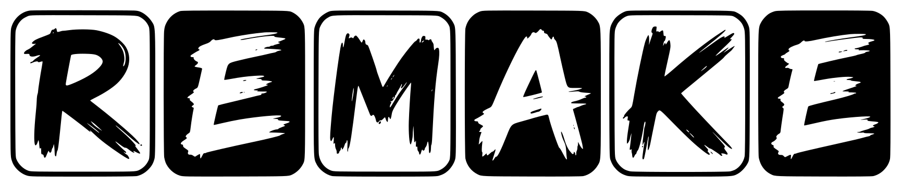
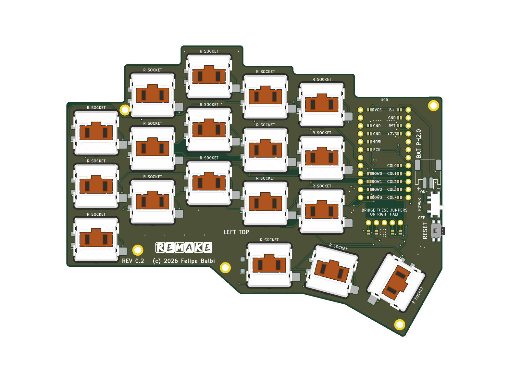
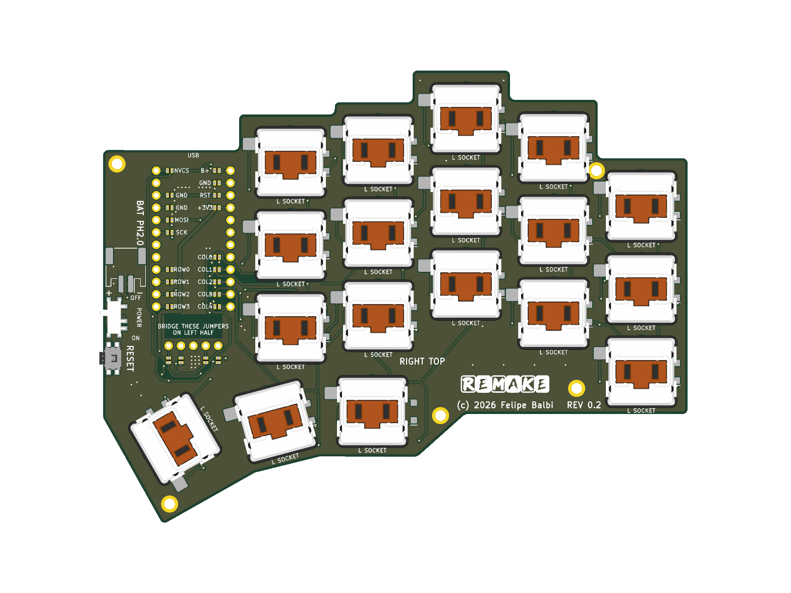
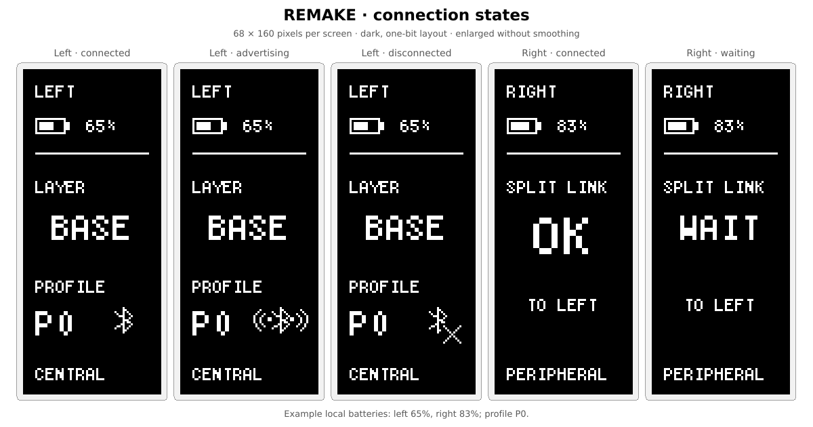
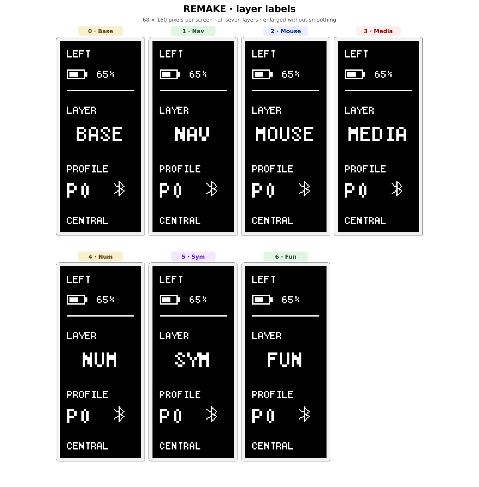
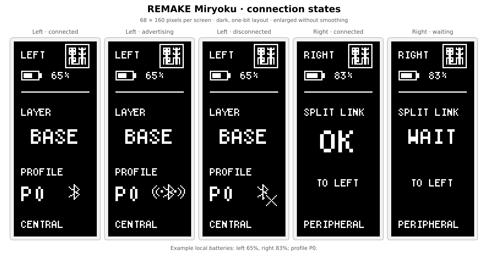
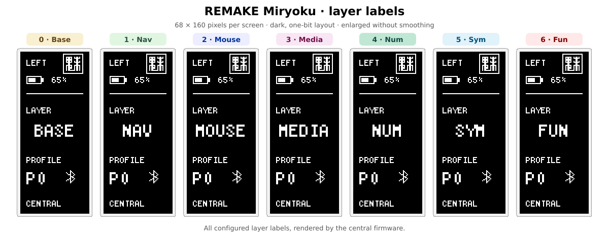

+++
title = "REMAKE: a small keyboard of my own"
date = 2026-11-09
draft = false
description = "Introducing REMAKE, a 36-key wireless split keyboard built around RMK, with a reversible PCB, nice!view displays, and a portable Miryoku firmware sample."
[taxonomies]
tags = ["embedded", "rust", "keyboards", "rmk", "bluetooth", "hardware"]
+++

Getting my [Urchin to run RMK](@/posts/urchin-tap-hold-and-power/index.md)
apparently wasn't the end of the keyboard project. Now I have a hardware
repository, too.

Meet **REMAKE**: a **36-key wireless split keyboard** designed around
[RMK](https://rmk.rs/), with nice!nano v2 controllers, low-profile Choc
switches, and an optional nice!view display on each half. The name has
**RMK** in it. That part of the design was considerably easier than the PCB.

The [hardware is on GitHub][hardware], and the [v0.2 release][release]
has the fabrication files, schematic, and PCB renders. There are also two
firmware repositories: [my personal configuration][personal-fw] and a
[portable Miryoku sample][miryoku-fw].

**One important qualification up front: v0.2 is development hardware,
not a fabrication-approved revision.** I'm sharing the design and its
current state, not announcing a finished kit. The release files being
available doesn't mean the remaining physical checks have been done.

<!-- more -->

## Eighteen keys, twice

Each half has three rows of five finger keys and a three-key thumb
cluster. The columns are staggered, the thumbs fan out below them, and
the stepped PCB outline follows that shape rather than putting the keys
inside a rectangular board.

*Left half, from the v0.2 release. These are partial PCB assembly renders,
not photographs of a completed keyboard.*

*Right half. The same PCB is populated in the opposite orientation.*

There is **one reversible PCB design**, not a separate board layout for
each hand. A keyboard uses two identical boards, with one assembled
front-side up and the other back-side up. No mirrored fabrication file,
panelization, or mouse bites are required.

That does move some complexity into assembly. The controller and display
connections use left/right selection links: populate the bank for the
half being built and leave the other bank open. Those links accept either
0402 zero-ohm resistors or hand-soldered bridges. **Connecting both banks
shorts signals, including power and ground.** The
[assembly guide][assembly] is part of the design, not optional reading
after the soldering iron is hot.

The switches are Kailh Choc v1 with hotswap sockets. Most keycaps have a
17.5 × 16.5 mm outside envelope; one thumb on each half uses a longer
26.5 × 16.5 mm cap. Those are actual design dimensions, not a promise that
anything sold under a particular unit-size label will fit.

## Two firmware starting points

Both firmware repositories use Rust and RMK, with Bluetooth between the
halves and USB or Bluetooth to the host. The keymap lives in
`keyboard.toml`, and Vial exposes the 36 physical keys for remapping.

They deliberately aren't the same configuration.

### The one I'm experimenting with

[rmk-remake][personal-fw] keeps **QWERTY** alphas and my existing home-row
modifier order, while adopting Miryoku's seven-layer structure: Base,
Nav, Mouse, Media, Num, Sym, and Fun. Each of the six thumb keys taps an
ordinary key and holds one of the six sublayers. Enter and Space remain
on my center thumbs.

This is also where I'm using the ordered tap-hold work from
[RMK PR #1347](https://github.com/rmk-rs/rmk/pull/1347). The repository
pins a specific revision of my RMK fork rather than tracking a moving
branch. Home-row modifiers use permissive hold and same-hand tap
filtering; the thumbs have a separate policy. There are four Bluetooth
host profiles.

Keeping QWERTY here is intentional. Learning the layer arrangement and
changing the alpha layout at the same time would make it harder to tell
which part I was struggling with.

### The sample that doesn't need my fork

[remake-miryoku][miryoku-fw] is the more portable starting point. It uses
**released RMK 0.9.x from crates.io**, without Git dependencies or local
source overrides, and Miryoku's default **Colemak Mod-DH** alphas. The
manifests allow compatible patch releases; both committed lockfiles
currently select RMK 0.9.0. It has the same seven layer names, Miryoku's
thumb arrangement and modifier positions, and **four Bluetooth host
profiles, BT0–BT3**, just like my personal configuration. Media puts the
output toggle and those four selectors on the right bottom row; the
unsupported RGB positions stay unbound.

This is an adaptation, not a claim of complete QMK or ZMK feature parity.
It doesn't include Auto Shift, layer locks, or the fork-only ordered
tap-hold behavior. The README documents those differences and credits
[Miryoku and manna-harbour][miryoku].

Both repositories include keymap diagrams and build instructions; the
personal repository also has a printable cheatsheet. If you want a
starting configuration without my
experimental RMK dependency, use the sample. If you want to see what I'm
changing for myself, use the personal repository.

## A little status, not a dashboard

The nice!view screens show battery status and connection information.
The central also shows the current layer and host profile; the peripheral
shows whether its link to the central is ready. A lightning bolt means
local USB power, **not** a measured charging state.

Both configurations have SVG previews generated from their firmware
renderers:

**My personal configuration:**

**Miryoku sample:**

The previews are enlarged for readability; their battery values are
examples, not measurements.

After 30 seconds idle, the firmware clears the screens and switches off
their supply. On wake, it reinitializes them and redraws the current
state. Split-link subrating is enabled to reduce idle radio activity.
That is connected sleep, not MCU System OFF.

The firmware repositories have native tests for the keymaps, display
rendering, sleep/wake handling, and other behavior. None of that gives
REMAKE a measured battery life. The current measurements from my Urchin
work belong to that setup; they aren't a runtime specification for this
board.

## Bill of materials

Here is the **per-half** parts list, reproduced from the
[v0.2 assembly documentation][assembly]. Double the quantities for a
complete keyboard; the nice!view is optional on each half.

| Quantity per half | Part |
|---:|---|
| 1 | REMAKE half PCB |
| 18 | Kailh Choc v1 switches and matching hotswap sockets |
| 17 | Keycaps, 17.5 × 16.5 mm outside envelopes |
| 1 | SW17 long thumb keycap, 26.5 × 16.5 mm outside envelope |
| 18 | 1N4148W switching diodes, SOD-123 |
| 18, or 22 with a display | 0 Ω links, 0402 imperial / 1005 metric; manual solder bridges may be used instead |
| 1 | Genuine nice!nano v2 |
| 2 × 12 | Controller socket contacts and matching pins; height must be validated |
| 1 | Optional nice!view and matching five-pin socket/header |
| 1 | MSK12C02 slide switch; exact manufacturer/variant and rating need approval |
| 1 | Panasonic EVQPUJ02K side-actuated, momentary SPST-NO reset switch |
| 1 | JST S2B-PH-SM4-TB, two-pin side-entry SMT, 2.0 mm pitch |
| 1 | Protected 3.7 V, 110 mAh 301230 battery with PH 2.0 connector |
| As needed | Battery insulation and suitable case/plate retention |

This isn't a fully qualified shopping list yet. In particular, some
MSK12C02 variants are rated for only 50 mA, below the nice!nano's nominal
default charging current through that path. The exact switch needs
approval; a matching footprint or family name isn't enough.

The battery also needs its polarity and charging limits checked. A PH
2.0 plug doesn't guarantee the wiring is correct. The documented PCB
connector is **pin 1 GND, pin 2 BAT+**, and the nice!nano charge-boost
jumper should remain open. Socket height, battery insulation, lead
clearance, and the final mechanical stack still need verification with
the real parts. Read the full assembly guide before ordering or powering
anything.

## What's in v0.2

The [REMAKE v0.2 release][release] includes:

- [The Gerber and drill ZIP, `remake-jlcpcb.zip`][gerbers].
- [The schematic PDF](https://github.com/6mil-Labs/remake/releases/download/v0.2/remake-schematic.pdf).
- The left/right PNG renders shown above and separate STEP previews.
- Model-coverage notes and SHA-256 checksums.

The fabrication ZIP contains **one PCB design**. A complete keyboard
needs two copies of that board, not one left and one right fabrication
package. It is a bare-PCB export, not a ready-to-order PCBA package with
population-selected assembly files.

The renders and STEP files use only redistributable models and omit some
geometry. The [model-coverage file][coverage] records those limitations.
They are useful previews, but they aren't proof that a controller,
display, battery, keycap, or case will fit.

Routing is complete, the ground pours are filled, and the outline is
closed. Physical keycap travel, production tolerances, the component
choices above, and the assembled mechanical and radio behavior still
need validation. Passing CAD checks is useful evidence about the CAD.
It doesn't finish the keyboard.

The hardware is licensed under [CERN-OHL-S-2.0][license]. If you're
interested in manufacturing boards or kits, there is a
[manufacturing and sales issue template][manufacturing-issue] for that
conversation. Commercial manufacture is permitted under the licence;
getting in touch isn't an extra permission requirement.

For now, the design, firmware, and release exports are there to inspect.
The next important results need to come from the physical assembly, not
another render.

I'll post an update once I have the keyboard assembled, with photos and
how it feels to actually type on it.

[hardware]: https://github.com/6mil-Labs/remake
[release]: https://github.com/6mil-Labs/remake/releases/tag/v0.2
[gerbers]: https://github.com/6mil-Labs/remake/releases/download/v0.2/remake-jlcpcb.zip
[assembly]: https://github.com/6mil-Labs/remake/blob/v0.2/docs/assembly.md
[coverage]: https://github.com/6mil-Labs/remake/releases/download/v0.2/remake-model-coverage.json
[personal-fw]: https://github.com/felipebalbi/rmk-remake
[miryoku-fw]: https://github.com/6mil-Labs/remake-miryoku
[miryoku]: https://github.com/manna-harbour/miryoku
[license]: https://github.com/6mil-Labs/remake/blob/v0.2/LICENSE
[manufacturing-issue]: https://github.com/6mil-Labs/remake/issues/new?template=manufacturing-and-sales.yml
