+++
title = "My Urchin was scanning faster than it needed to"
date = 2026-11-22
draft = false
description = "Short settling waits and paced scans reduce my Urchin's active current. Pacing-only measurements help separate the changes; dropping SPIM between display operations shows no useful net saving."
[taxonomies]
tags = ["embedded", "rust", "keyboards", "rmk", "bluetooth", "low-power"]
+++

In the [previous post](@/posts/urchin-system-off-and-wakeup/index.md),
I got my Urchin measurement board down to about **19.8 µA in SYSTEM_OFF**.
That required dropping its Bluetooth connections and rebooting when a
local key woke it. It was an interesting overnight experiment, but the
daily-budget example had an inconvenient conclusion: active time still
accounted for most of the charge.

This time I looked at the keyboard while it was doing something.

There are two results worth keeping from this first set of measurements.
Short settling waits and paced scans brought the held-switch average from about
**4.30 mA to 2.07 mA**. Repeatedly tapping the same switch brought it from
**2.66 mA to 1.56 mA**. Constructing and dropping the display's SPI driver
between operations did not show a useful net saving.

Whether that buys more time between charges is still an open question.
These are short bench comparisons, with only one populated
switch on this measurement board. It can tell me quite a lot about
scanning, and much less about typing a sentence with overlapping keys.

<!-- more -->

## Start with the baseline we actually built

The earlier articles followed display sleep, split discovery, connection
subrating, and the low-frequency crystal. This experiment keeps those
questions separate. I am not comparing an old release with a new image
containing every change I could think of.

The prepared images start from
[Urchin revision `580db2ce`](https://github.com/felipebalbi/rmk-urchin/commit/580db2ce97625ae9bad5073990d15618a6fb16e8),
with all four variants using the same published
[RMK revision `0d9c3020`](https://github.com/felipebalbi/rmk/commit/0d9c302094dfc2aacc62263d09b19f7013e18611).
They were built with Rust **1.100.0**, in release mode, with locked
dependencies. The recorded build working tree was clean.

That RMK revision includes the rebased ordered tap-hold work and an
upstream API/configuration migration. Updating RMK is a baseline change,
not an active-power optimization. The older articles' numbers are useful
context, but they are not interchangeable controls for these captures.

I prepared four variants:

| Variant | Active matrix scanning | Display SPIM driver |
| --- | --- | --- |
| Baseline | Existing scan policy | Retained between operations |
| Matrix | Short settling wait and 1 ms active-scan gap | Retained |
| SPIM | Existing scan policy | Constructed and dropped for each operation |
| Both | Experimental matrix policy | Constructed and dropped for each operation |

None changes the BLE interval policy, regulator settings, external LF
crystal configuration, display content policy, or 16 ms COM-maintenance
cadence. The debounce setting remains **5 ms**.

The PPK2 was in **source-meter mode at 4,200 mV**. These new captures
measure the powered measurement board, not the display supply or the
SPIM peripheral in isolation. The main comparison windows are all
**10 seconds** long. I use the PPK2's whole-window average and charge,
not the height of the turquoise envelope.

## A clean bond is not a connected keyboard

My first capture was not a useful established-connection comparison.
I had flashed `both` but hadn't paired the keyboard.

[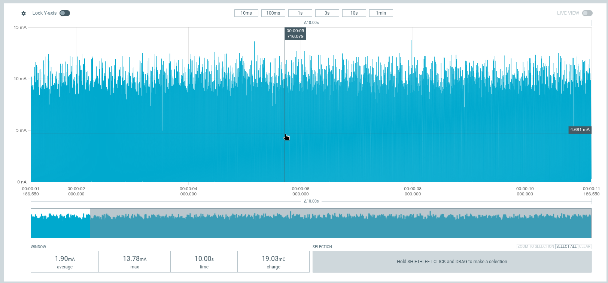](unpaired-both.png)

*Retained as a record of the setup mistake. Its 1.90 mA is not an active
typing result and is excluded from the workload comparisons below.*

For the tests, I prepared separate images with RMK's
`[storage] clear_storage = true`. They clear all stored settings and
bonds on **every application boot**, not merely after flashing. That
makes it possible to start from clean stored state, provided I also
remove the old host record and pair again. It clears saved mappings and
split bonds too; this is temporary test firmware, not how I want the
daily keyboard to behave.

On Linux, a Bash script removes the measurement keyboard's host record,
discovers it, pairs through a persistent agent, trusts it, and connects.
It checks the resulting state rather than declaring success because a
CLI command printed a friendly sentence. It does not establish the
separate connection between keyboard halves.

The script had its own fairly embarrassing power-test distraction.
I treated `bluetoothctl --timeout 30` as a maximum wait. BlueZ keeps
completed commands alive for the full duration. Four commands before
scanning could therefore consume roughly **two minutes** while the
keyboard's advertising window disappeared.

A read-only check on the host made that obvious: `show` took **5.025 s**
with `--timeout 5`, versus **0.022 s** without it. One-shot commands now
use an external maximum timeout. The script also reads
`ServicesResolved` over D-Bus because this BlueZ version doesn't print
that property in `bluetoothctl info`.

There is a second timing detail to finish recording. RMK waits five
seconds before requesting a **15 ms** host connection interval, then
waits another five seconds before requesting **7.5 ms**. Those requests
use peripheral latencies of 30 and 60 respectively. Requests are not
proof of what the host accepted.

The pairing script initially waited only five seconds before reporting
readiness. For subsequent runs I want a consistent longer settling
period and an HCI capture of the actual accepted parameters, as in the
[connected-sleep investigation](@/posts/urchin-connected-sleep-and-clocks/index.md#what-did-the-host-actually-agree-to).
I did not record negotiated parameters or exact post-connection timing
for each of the first captures below. They remain preliminary results,
not a fully controlled BLE benchmark.

## Two changes to the scanner, not to the matrix wiring

The matrix experiment changes firmware timing. The pins, physical
switches, layout, and debounce configuration stay put.

The first change is the settling wait after a scan output is driven
high. Baseline uses:

```rust
Timer::after_micros(1).await;
```

The prototype uses:

```rust
cortex_m::asm::delay(64);
```

The nRF52840 CPU runs at 64 MHz, so this is nominally a short 1 µs
busy-wait without scheduling an asynchronous timer. Our Embassy clock
runs at 32,768 Hz: one tick is about **30.5 µs**. Asking an RTC-backed
timer for one microsecond doesn't make it a calibrated one-microsecond
electrical delay. The replacement isn't a calibrated delay either;
actual settling time still needs checking on the pins.

The second change is the more obvious power experiment. While a key is
held, or debounce is in progress, baseline continues rescanning without
an explicit gap between complete active passes. The prototype adds:

```rust
Timer::after_millis(1).await;
```

That bounds sustained polling to roughly **1,000 passes per second or
less**, including scan and scheduling overhead. It gives the executor
a waiting interval instead of immediately beginning the next pass.

When no key requires rescanning, the scanner still waits on GPIO.
There is no new periodic idle poll and no fixed 1 ms delay inserted
before the first scan after GPIO wake. The prototype also yields after
idle waits so an immediate GPIO error or spurious condition cannot
create a cooperative-executor spin.

The [pinned scanner source](https://github.com/felipebalbi/rmk/blob/0d9c302094dfc2aacc62263d09b19f7013e18611/rmk/src/matrix.rs#L373-L456)
contains both timing changes. The first measurements use them together.
I then restored the original settling timer to see how much of the
improvement remained with pacing alone.

## Hold one switch and complete the four-way comparison

The measurement board's populated key is physical **F**. In my layout,
it is `MT(F, LCtrl)`: a short tap is F, and a sustained hold normally
becomes Left Ctrl. "Held F" below means holding that physical switch,
not making the host repeat the letter F.

That keeps the local scanner active and gives the variants a simple
workload to compare.

| Held physical F | Average current | Maximum | Charge over 10 s |
| --- | ---: | ---: | ---: |
| Baseline | **4.30 mA** | 12.73 mA | **42.98 mC** |
| Matrix | **2.07 mA** | 14.29 mA | **20.72 mC** |
| SPIM | **4.36 mA** | 12.68 mA | **43.60 mC** |
| Both | **2.05 mA** | 13.42 mA | **20.47 mC** |

[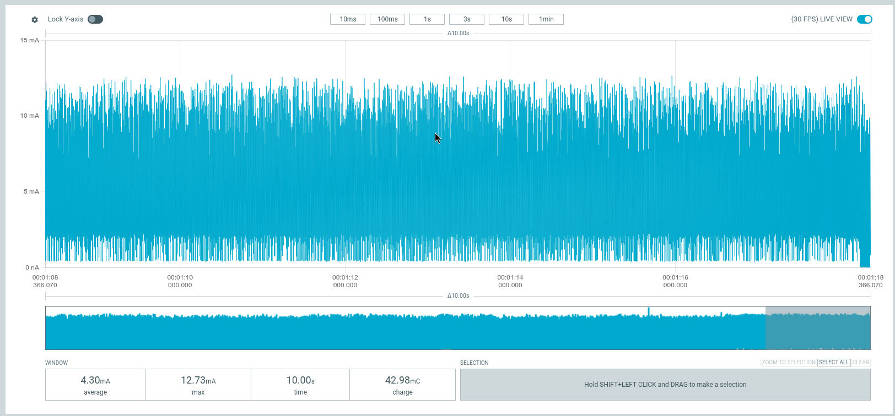](baseline-held-f.jpg)

[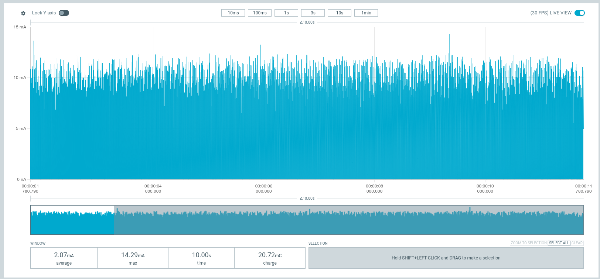](matrix-held-f.png)

*The matrix capture still has tall peaks. The improvement is in average
current and integrated charge, not a reduction in peak amplitude.*

Matrix-only uses about **52% less charge** than baseline in these
windows. `Both` is nearly the same as matrix-only.

[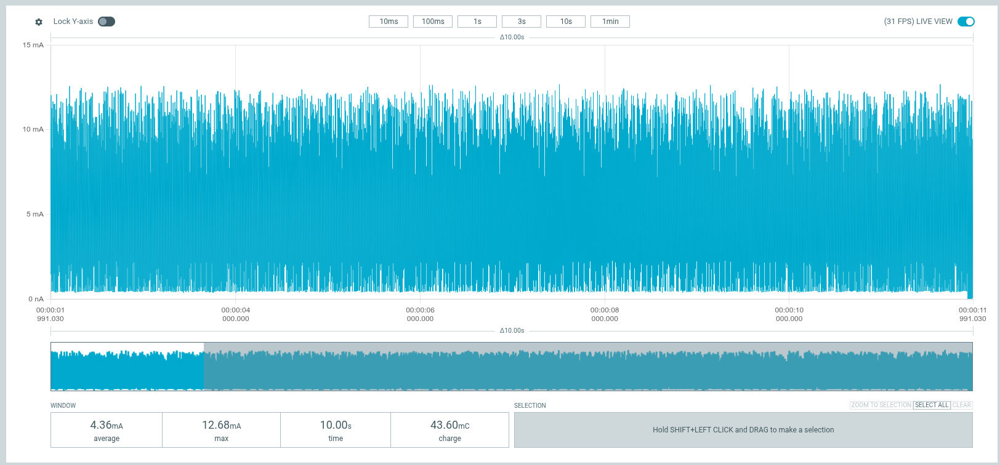](spim-held-f.jpg)

[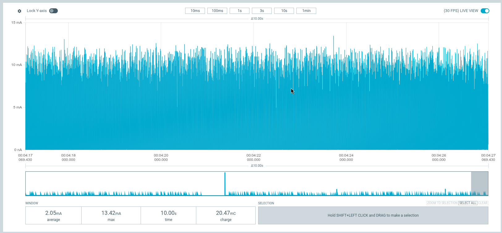](both-held-f.png)

These are single captures per variant, not repeated trials with error
bars. The pattern nevertheless points in a useful direction: the
**matrix variant** accounts for the substantial held-switch reduction.
The tiny difference between matrix and both doesn't establish another
saving from SPIM.

## The display-driver lifetime wasn't the missing milliamp

The SPIM variant retains ownership tokens and configuration between
operations, but constructs the HAL driver for each display operation,
flushes, and drops it afterward. Driver drop disables the peripheral;
SCK and MOSI are then parked low.

It keeps the existing DMA cancellation protection. An unfinished
transfer still has to stop before its buffers and driver can be
released. As in the [first investigation](@/posts/urchin-tap-hold-and-power/index.md#a-cancellation-guard-wasn-t-the-answer-either),
removing a safety mechanism isn't the way to make this number smaller.

SPIM-only came out slightly above baseline in the held-switch test:
**4.36 mA versus 4.30 mA**. I don't have enough repeated measurements
to call that small difference a regression. I certainly don't have
evidence of a useful saving.

That doesn't establish the electrical cost of "keeping the SPI clock
on." A retained driver isn't proof that the clock runs continuously.
The retained peripheral might have very little idle cost, or the cost
of reconstructing it might offset a small saving. These whole-board
measurements don't distinguish those explanations.

For this workload, the extra lifecycle complexity has not earned its
place. Display-heavy activity remains unmeasured.

## Awake without typing barely moved

I also compared baseline and both while awake without typing:

| Awake, no typing | Average current | Maximum | Charge over 10 s |
| --- | ---: | ---: | ---: |
| Baseline | **968.21 µA** | 12.33 mA | **9.68 mC** |
| Both | **975.70 µA** | 12.30 mA | **9.76 mC** |

[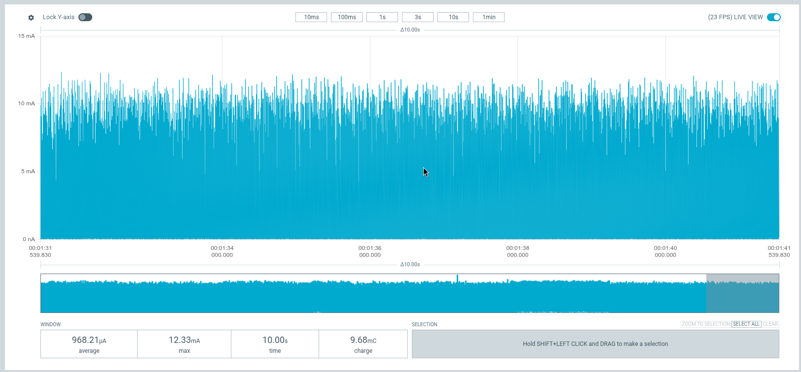](baseline-awake-idle.png)

[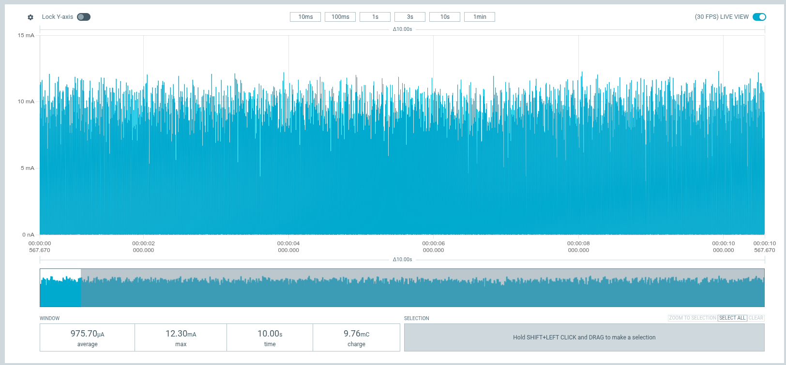](both-awake-idle.png)

The difference is **7.49 µA**, or about **0.77%** of baseline. Without
repeated runs, I can't separate that from ordinary variation. There is
**no demonstrated awake-idle saving** in this pair.

That fits the scope of the matrix change: it adds pacing while scanning
is active, not a new periodic job while the matrix is idle. It is not
proof of which MCU or radio activity remains responsible for the idle
average. I also haven't measured matrix-only and SPIM-only awake idle
separately yet.

## Now release the key occasionally

Holding a switch is useful for exercising sustained scanning. It is
not how I type. With one populated key, the next available experiment
was repeatedly tapping F instead.

I tried to keep the manual rhythm as close as possible between baseline
and matrix-only. The tap counts were approximately the same, and I
kept all other conditions the same. I did not record exact counts or
press durations. Every F tap registered.

| Repeated manual F taps | Average current | Maximum | Charge over 10 s |
| --- | ---: | ---: | ---: |
| Baseline | **2.66 mA** | 12.65 mA | **26.65 mC** |
| Matrix | **1.56 mA** | 13.92 mA | **15.62 mC** |

[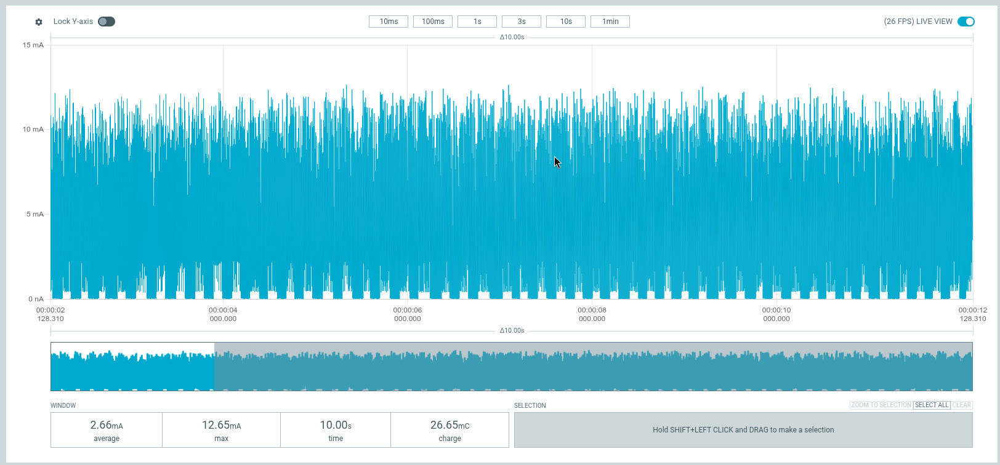](baseline-tapping-f.jpg)

[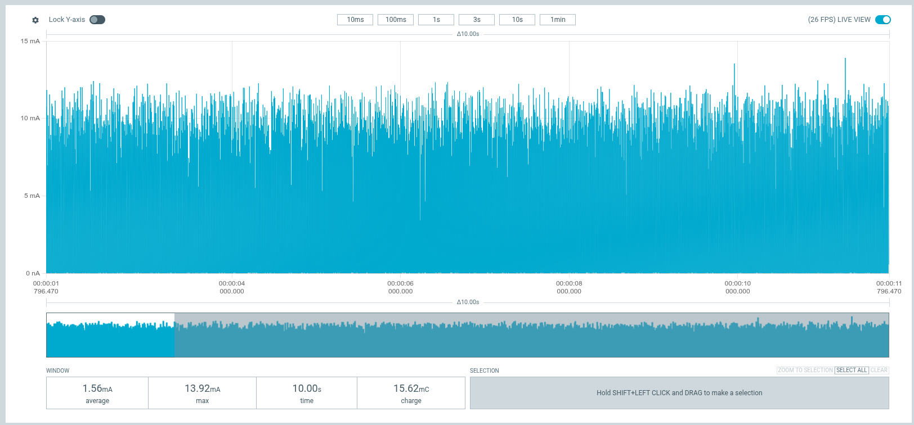](matrix-tapping-f.png)

The matrix window contains **11.03 mC less charge**, a **41.4%**
reduction relative to the baseline window. That percentage is a
description of these captures, not a repeatable typing-savings estimate
accurate to a decimal place.

The same direction in both held-switch and repeated-tap workloads is
encouraging. Repeated taps exercise wake, scanning, debounce, and release
instead of keeping the scanner active continuously. But manual changes
in press duration change how long the scanner stays active. Approximate
tap counts aren't enough to calculate a defensible charge per tap.

Nor does every F registering validate home-row rolls, overlapping keys,
layer chords, split delivery, latency, or sleep/wake. That needs the
fully populated keyboard.

## What if the scan gap did all the work?

Before generalizing the 64-cycle delay, I wanted to answer a simpler
question: perhaps the 1 ms pause explained the entire improvement, and
replacing the per-output timer hadn't helped at all.

I built a **pacing-only** central image. It restores
`Timer::after_micros(1).await` after selecting each output, but keeps
the 1 ms active-scan gap and the yield after idle waits. SPIM stays on
baseline behavior, and erase-on-boot remains enabled.

This image uses frozen local snapshots of the same Urchin and RMK
revisions as the earlier measurements, plus the
[settling-hunk removal](build-records/erase-pacing-only/pacing-only.patch).
It doesn't use the newer upstream branch I started for cleanup. The
four RMK packages resolve from that patched snapshot; all other package
versions, sources, and checksums remain unchanged. Its source and build
records identify that difference rather than calling it an unmodified
published RMK build.

| Workload | Baseline average / charge | Pacing-only average / charge | Both matrix changes average / charge |
| --- | ---: | ---: | ---: |
| Held physical F | 4.30 mA / 42.98 mC | **3.44 mA / 34.42 mC** | 2.07 mA / 20.72 mC |
| Repeated manual F taps | 2.66 mA / 26.65 mC | **2.23 mA / 22.33 mC** | 1.56 mA / 15.62 mC |

*Each charge figure covers a 10-second window. "Both matrix changes"
means short settling plus scan pacing, not the separate `both` variant
that also changes SPIM lifetime.*

[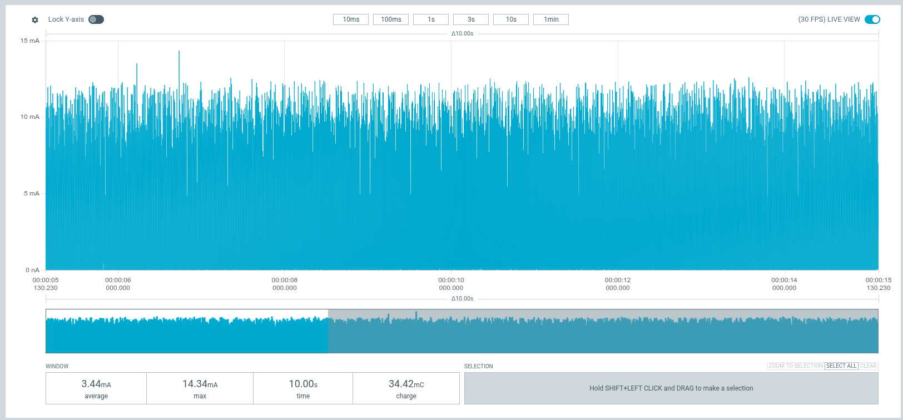](pacing-only-held-f.png)

[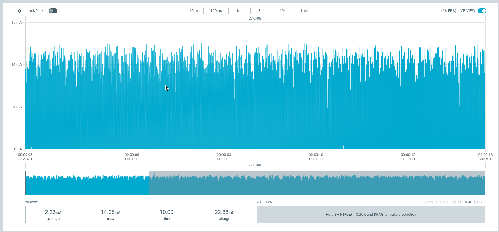](pacing-only-tapping-f.png)

Pacing alone reduced charge by about **20% while held** and **16% while
tapping**, relative to the earlier baseline windows. That is useful,
but well short of the roughly 52% and 41% reductions with both matrix
changes.

Restoring the per-output timer increased the held-switch average from
2.07 mA to 3.44 mA, and the tapping average from 1.56 mA to 2.23 mA.
There is a practical reason to keep investigating the short settling
wait, rather than treating it as incidental cleanup.

That comparison measures its benefit **with pacing already enabled**.
I still haven't measured short settling on its own, or repeated these
trials enough to put error bars on the differences. The two changes may
interact; this isn't a way to assign each a fixed number of microamps.
The tapping rhythm is still manual, and negotiated BLE parameters were
not recorded for every run.

Embassy hasn't disappeared from the scanner: it still provides the
1 ms pacing timer. What changes is the repeated short wait after each
output selection. Avoiding those waits helps in this configuration;
the traces alone don't identify how much comes from timer scheduling,
RTC tick quantization, or the work between scans.

## Where I stopped

The first active-power captures support a useful, limited conclusion:
the **matrix timing experiment** roughly halves held-switch consumption
and reduces charge during approximately matched manual single-key
tapping. Pacing-only measurements show a smaller improvement, supporting
short settling as an additional benefit when pacing is enabled. The
SPIM lifetime experiment shows no useful net benefit in
the measured workload. Awake-idle consumption is nearly unchanged.

The [measurement summary](measurement-summary.json) and
[table of GUI measurements](measurements.csv) retain all the numbers,
original screenshot hashes, prepared build provenance, and unresolved
metadata. There are no raw current exports attached to this set yet;
the table is transcribed from the PPK2 GUI, not reconstructed from
sample data.

Before publishing a stronger claim, I want repeated alternating
baseline/matrix trials, counted taps with a repeatable rhythm, recorded
BLE negotiation, and input testing on the full keyboard. The run record
also still needs the exact flashed image checksums, measurement role
and supply insertion point, peer firmware and connection state,
USB/debug connections, display state, and acquisition sample rate.
Those details should not be inferred from an older experiment or from
the GUI's live-view frame rate.

There is no battery-runtime table this time. One held switch and a few
seconds tapping F don't tell me how many days a real typing workload
will buy. They do tell me where the next experiment is worth spending
time: on the scanner, not on making the SPI driver disappear between
two-byte display commands.
