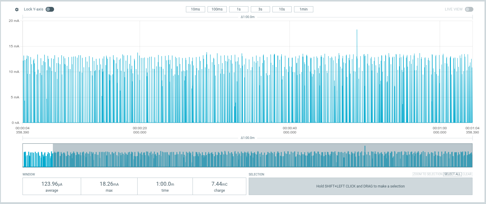
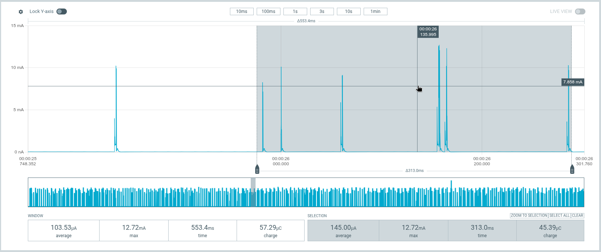
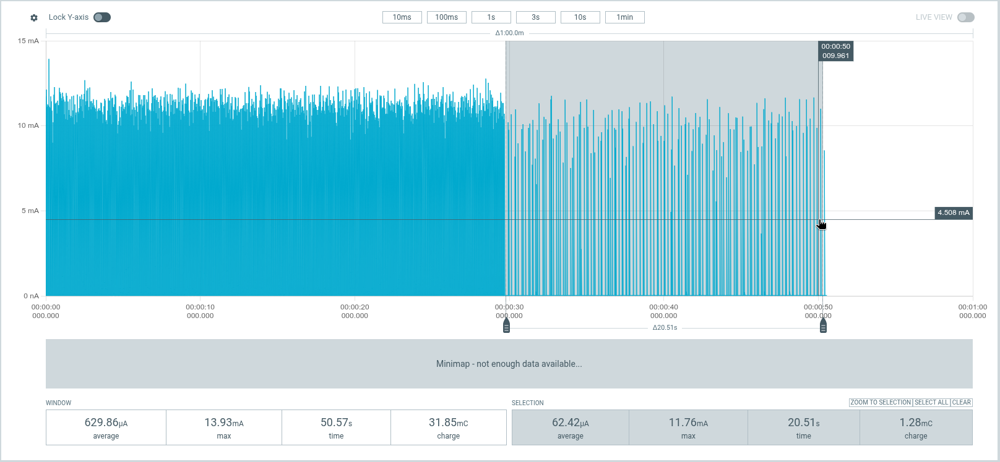
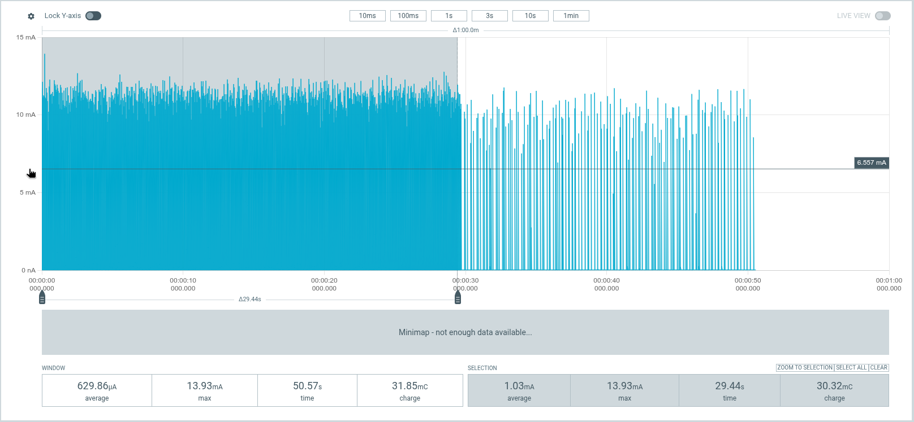
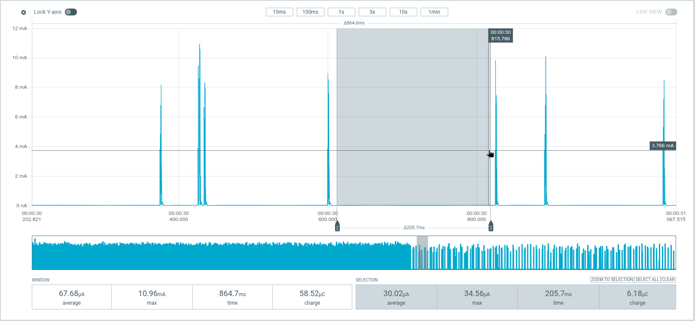
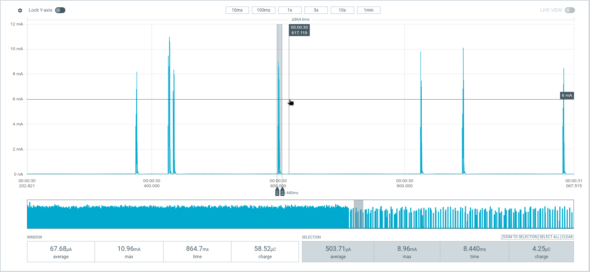
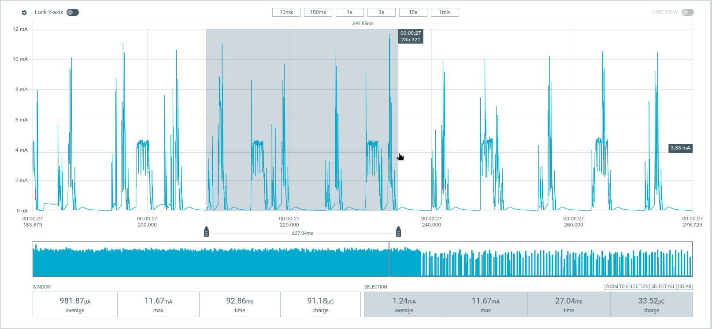

+++
title = "My sleeping Urchin had a perfectly good crystal it wasn't using"
date = 2026-11-04
draft = true
description = "Following the remaining connected-idle current through BLE subrating, unnecessary wakeups, a failed latency estimate, and the nice!nano's unused low-frequency crystal."
[taxonomies]
tags = ["embedded", "rust", "keyboards", "rmk", "bluetooth", "low-power"]
+++

In the [previous post](@/posts/urchin-tap-hold-and-power/index.md), I
managed to stop blaming the displays for power that was going into a
radio search. The screens slept, the halves stayed connected, and the
peripheral settled at about **47 µA**.

The central was still around **270–300 µA** while sleeping with both
the host and the other half connected. I'd enabled connection subrating,
but hadn't measured it yet.

This time I did. Then I removed a couple of things I didn't need, tried
a change that failed to save what I expected, and eventually noticed
that the genuine nice!nano v2 had a perfectly good low-frequency crystal
that my firmware wasn't using.

The final central measurement was about **62 µA asleep**, with both BLE
connections retained, and about **1.03 mA awake without typing**.

The quiet current between bursts barely moved. The bursts got cheaper.

<!-- more -->

## The keyboard still has to be a keyboard

The target wasn't the lowest number I could make the PPK2 display. I
could get a lower number by disconnecting things. That wasn't the
keyboard I wanted to use.

My halves sleep through the night while connected to each other, and
the central stays connected to the host. A keypress should wake the
keyboard without making me wait for discovery and reconnection. This
is connected idle, not MCU System OFF.

I used a partially populated Urchin measurement board with a genuine
nice!nano v2 and one populated key for wakeup. The PPK2 supplied the
central through its battery connection; keyboard USB was disconnected
during current measurements. The peripheral had its own power.

The captures in this post are from October 31. They're selected
measurement windows, not a battery rundown test.

USB logging would have rather defeated that arrangement. Host-side
Bluetooth capture, on the other hand, didn't need another wire into
the keyboard.

The host was Linux `7.2.11-arch1-1`, with BlueZ `5.87-2`. It also had my
mouse and actual daily-use keyboard connected, so identifying the
measurement keyboard mattered. So did keeping those packets out of the
explanation for its current trace.

## Subrating did help

The first useful correction was simple: I hadn't actually measured the
subrating-enabled firmware.

With it enabled on both halves, initial connected-sleep observations
were around **117–124 µA**. This one-minute screenshot averages
**123.96 µA**:

[](subrating-minute.png)

*Already much better than 270–300 µA. The tall peaks are still there;
their height isn't the average.*

Zooming in, I could select a quiet gap at about **30 µA**, followed by
short bursts reaching milliamps. Selecting only that gap would have
made for a lovely sleep-current claim. It would also have left out
most of what the keyboard was doing while asleep.

At first the spacing looked irregular:

[](overlapping-events.png)

*This selection is deliberately burst-rich. Neither its 145 µA nor the
quiet gap's 30 µA replaces a representative whole-window average.*

The CSV exports were more useful than eyeballing the screenshot. The
PPK2 samples were **10 µs apart**. Among the uneven gaps, there was a
very regular train at approximately **225 ms**: a good match for the
split link's factor-30 subrating on its 7.5 ms base interval. Other
activity sat between those events.

Two links with different schedules don't owe me one tidy pulse train.

## A useful detour that wasn't the goal

I powered off host Bluetooth with `bluetoothctl power off`, left the
peripheral connected, and waited for the central's host advertising
to time out. That advertising session lasts five minutes; measuring
the reconnection attempt would have answered a different question.

The result was **59.38 µA** over a minute. But the 225 ms train was
still there.

The pinned RMK implementation chose its sleeping split settings when
sleep state changed. Losing the host while already asleep didn't
necessarily make it choose again. A keypress followed by another idle
timeout did: with the host still off, the train became approximately
**750 ms**, and a 21.91-second capture averaged **44.60 µA**.[^sleep-policy]

That was useful evidence about when the policy ran. It was not the
answer to overnight connected consumption. I turned the host back on.

Easy to get distracted by a better number. Especially when the number
is real, but belongs to a setup I don't intend to use.

## What did the host actually agree to?

Back in connected sleep, a steadier 30.72-second capture averaged
**86.52 µA**. Earlier windows had been higher, including occasional
clusters of much more expensive activity. That variability was a
reason to keep looking at charge and timing, not to pick whichever
average made the next change look best.

I used `btmon` to record host HCI traffic:

```sh
sudo btmon -w urchin-connected-sleep.btsnoop
```

The measurement keyboard had its own connection handle. Once mapped
to its address, the other keyboard and mouse could be excluded. There
were **no ACL packets for the measurement keyboard** in that settled
capture.

That did **not** mean its radio had stopped. Empty link-layer exchanges,
retransmissions, and the separate split link aren't exposed as ordinary
application packets in this host capture. It only ruled out a stream
of host-visible application traffic as the explanation for that window.

To learn the negotiated parameters, I started another capture before
power-cycling the measurement central. Requests aren't proof of
acceptance; the successful completion events were the useful part.

The host link ended up at:

| Parameter | Negotiated value |
| --- | ---: |
| Connection interval | 7.5 ms |
| Peripheral latency | 60 |
| Supervision timeout | 6 seconds |
| TX / RX PHY | 2M / 2M |

RMK first requested 15 ms with latency 30, then 7.5 ms with latency 60.
Linux accepted both updates. This matched the roughly **457.5–465 ms**
spacing of the larger, host-like events in the current trace.

## Stop computing a number I don't use

My application explicitly started RMK's words-per-minute processor.
I don't display WPM. I don't use it for anything else either.

It still woke once a second to compute it.

Removing the task eliminated one of the one-second burst trains.
The next capture averaged **85.27 µA**, compared with 86.52 µA before.
That's a small difference, and these aren't repeated controlled trials
with an error bar. The clearer evidence was the missing train, not a
claim that the subtraction gave its exact cost.

There was another one-second path. RMK's USB LED-report reader tried
to read from its HID OUT endpoint even with USB disconnected. A
disabled-endpoint error led to a one-second wait and another attempt.

Embassy already has a way to wait until the endpoint is enabled:

```rust
self.hid_reader.ready().await;
self.hid_reader.read(&mut buf).await?;
```

The gate is **endpoint readiness**, not merely USB voltage being
present. A charger can supply voltage without enumerating a keyboard.

With that wait added, the other one-second train disappeared. The
capture averaged **85.51 µA**, though, slightly *higher* than the
WPM-only image. A larger burst cluster raised that window's average.
Again, the waveform supported removal of the repeated work; the total
didn't establish a precise saving for the one-line fix.

The [USB readiness fix has a pending PR against RMK](https://github.com/rmk-rs/rmk/pull/1387).
It stays separate from the application clock choice. Tests
exercise disabled-endpoint waiting, report delivery after enablement,
disconnect/re-enable behavior, and preservation of other read errors.
They don't measure microamps.

## Fewer events, more expensive events

The next trial increased host peripheral latency from **60 to 120
while asleep**, restoring 60 on wake. The interval stayed at 7.5 ms,
the supervision timeout at six seconds, and split settings stayed put.

The tempting calculation was: ordinary host-like events cost about
10–12 µC each; double their spacing and save roughly **11–13 µA**.
Peripheral latency permits skipping idle events; it doesn't inherently
force pending key data to wait for the full idle spacing.

Linux accepted latency 120. The event spacing did roughly double,
from about 460 ms to about 910 ms.

The capture averaged **90.36 µA**.

So much for that estimate.

Using the same threshold-based measurement on both exports, the median
partial excess charge of ordinary host-like bursts increased from
about **10.47 µC to 16.90 µC**. There were also three expensive clusters
in the new capture, compared with one in the USB-only capture.

The ordinary activity looked better between those clusters, but the
clusters weren't a spreadsheet error. The battery pays for them too.
I couldn't delete them from the average and call it a win.

The estimate had assumed nearly constant charge per event. The
measurement had just told me that assumption was wrong.

## The crystal was already on the board

One explanation worth checking was receive-window widening. If the
clocks can drift while the devices skip events, the receiver needs
timing allowance when it listens again. Longer gaps can mean more
listening, not just fewer wakeups.

RMK's generated nRF initialization selected the **internal LFRC** for
MPSL and declared **500 ppm** accuracy. Embassy's default configuration
also selected LFRC. That was a coherent configuration. It just wasn't
using the hardware this board had available.

The [official nice!nano v2 schematic](https://nicekeyboards.com/docs/nice-nano/pinout-schematic/)
shows a populated **32.768 kHz crystal**. No soldering required.

I changed the central to use it consistently in both Embassy and
MPSL, leaving the latency-120 experiment in place. The MPSL
configuration became:

```rust
nrf_sdc::mpsl::raw::mpsl_clock_lfclk_cfg_t {
    source: nrf_sdc::mpsl::raw::MPSL_CLOCK_LF_SRC_XTAL as u8,
    rc_ctiv: 0,
    rc_temp_ctiv: 0,
    accuracy_ppm: 50,
    skip_wait_lfclk_started: false,
}
```

Both RC calibration fields must be zero for a non-RC source. Embassy
also needs `LfclkSource::ExternalXtal`; changing only the MPSL
declaration isn't the whole initialization.

The **50 ppm** value is the
[crystal-clock reference used by Zephyr](https://github.com/zephyrproject-rtos/zephyr/blob/0534e997eacb94bae1df6c9a7dd4a9a6cbf1cecf/drivers/clock_control/Kconfig.nrf#L81-L123),
not a tolerance I independently verified from the nice!nano crystal's
part number. The schematic confirms the crystal exists, not its
worst-case accuracy across temperature and load. This is a tested
configuration, not a new specification for the board.

I was surprised enough by the result to take a full minute:
**70.77 µA**. The host still reported 7.5 ms, latency 120, six-second
supervision, and 2M PHY in both directions. The quiet floor was still
about 29–30 µA.

That supports clock configuration as a useful improvement. It doesn't
identify every burst or prove receive-window widening caused every
extra microcoulomb in the earlier capture. Crystal selection and the
accuracy declaration changed together, and RC calibration was no
longer required. I didn't measure those effects separately.

## Keep the board choice in the application

I briefly went down the route of adding configuration override hooks
to RMK so the application could select both configurations while
keeping generated startup.

Then I asked the simpler question: couldn't the application already
do this through `#[Override(chip_init)]`?

Yes. It could.

That's where I left it. Urchin now uses the existing chip-init override
on both halves, with shared board-specific clock configuration. The
startup retains RMK's peripheral assignments, MPSL task, controller
memory sizing, RNG, regulator settings, and device-derived BLE address.
The cost is maintaining that startup code alongside RMK updates. No new
override API, and no global assumption that every nRF keyboard has a
crystal.

I also updated to current upstream RMK with my tap-hold work and the
USB readiness fix integrated. The final firmware **does not include
the latency-120 experiment**: the normal host policy returns to latency
60. Both halves select their LF crystals, whereas the first crystal
diagnostic changed only the central.

Those distinctions matter. The final image isn't the 70.77 µA
diagnostic with one more line changed.

The [application commit](https://github.com/felipebalbi/rmk-urchin/commit/f0b4cb9879a31e7ffa18362ed75035494bb97528)
contains the final setup. Its firmware and native checks pin the same
RMK integration revision. The application still has 45 passing host
tests, and both release images build. The current measurements are the
physical check those tests can't provide.

## About a milliamp awake, 62 microamps asleep

The final `chip_init` image gave me **1.030 mA** over the first 29
seconds of the CSV, then **62.07 µA** over the 20.57 seconds starting
at the 30-second mark. The transition was around 29.6–29.7 seconds
into this recording.

[](final-connected-sleep.png)

*The GUI selection is 62.42 µA over 20.51 seconds. The CSV calculation
starts at a slightly different boundary and gives 62.07 µA over
20.57 seconds. Both say about 62 µA; neither is the whole recording's
629.86 µA GUI average.*

[](final-awake.png)

*Awake, without typing. This includes the running firmware and display
maintenance, not an isolated panel-supply measurement.*

The previous integration image, before moving to the application's
chip-init override, measured **62.54 µA** over its final 30 seconds.
The two captures show no meaningful power regression from removing
the new override idea.

The quiet gap still looks much like the one at the beginning:

[](final-quiet-floor.png)

*This is a gap between events, not the connected-sleep average. The
final CSV's samples below 100 µA average about 29.56 µA, another way
of estimating that floor, not an independent hardware measurement.*

And the events still matter:

[](final-event-charge.png)

*The selection contains 4.25 µC over 8.44 ms. That's a selected window
including surrounding current, not a claim that the radio transmitted
for 8.44 ms.*

In the final sleep trace there is still a split-like 225 ms schedule
and host-like activity around 460 ms. Keeping the links costs energy.
I'm not trying to make those peaks disappear by cropping them out.

The awake trace is busier:

[](final-awake-detail.png)

*Useful evidence for another investigation, not proof that every
plateau belongs to SPI or that every spike is a radio packet.*

## What does that buy a 110 mAh battery?

Each half of my Urchin has a **110 mAh battery**, not 100 mAh. I've
added that clarification to the previous post too. The halves have
separate batteries; I can't pool 220 mAh and divide it by central
current.

For a deliberately simple **central-only, continuously sleeping**
estimate:

```text
hours = nominal capacity in mAh / average current in mA
```

| Central sleep current | Ideal runtime from 110 mAh |
| --- | ---: |
| 270–300 µA, previous non-subrated measurements | About 15–17 days |
| 124 µA, initial subrating-enabled minute | About 37 days |
| 62.07 µA, final connected-sleep window | About 74 days |

From the old 270–300 µA range to roughly 62 µA, that's **77–79% less
sleep current**, or about **4.3–4.8 times the ideal sleep-only runtime**.
From the initial 124 µA subrating capture, it's approximately a halving
of current and a doubling of that ideal runtime.

That's not a promise of 74 days between charges. It excludes typing,
reconnections, battery self-discharge, usable capacity lost to cutoff,
temperature, and aging. These captures also span firmware revisions,
so this isn't a controlled attribution of the total gain to the
crystal alone. The older 47 µA peripheral result isn't a fresh
measurement of the updated peripheral either.

The overnight arithmetic is less ambitious and more directly useful:
eight hours at 270–300 µA costs **2.16–2.40 mAh** on the central;
eight hours at 62.07 µA costs about **0.50 mAh**. Roughly
**1.66–1.90 mAh saved per eight-hour night**, without intentionally
dropping either connection.

For a usage example, assume four hours per day at the measured
**1.03 mA awake-idle current** and twenty hours asleep. The new budget
is about **5.36 mAh/day**, or **20.5 ideal days**. Holding that same
awake current fixed but substituting the old 270–300 µA sleep current
gives **10.9–11.6 ideal days**. That's roughly **1.8–1.9 times the
runtime in that model**.

Four hours of awake idle isn't a measured typing day. I'm using the
same awake budget on both sides to show how sleep consumption affects
the result, not claiming I measured that daily autonomy.

## There are still microamps left to explain

The remaining floor is around **29–30 µA**, nearly half the final
connected-sleep average. I haven't isolated its components yet.

The display task stops periodic work and cuts panel power, but its
SPIM2 driver remains alive. The battery ADC stops each conversion but
remains configured between samples. Those are investigation targets,
not established leaks. "Enabled" in a register isn't enough to assign
a current to it.

Battery sampling still happens every **30 seconds during sleep**.
An unchanged percentage isn't republished, so that doesn't imply a
host notification every 30 seconds. Flexible application work could
be batched or deferred, but the BLE links have negotiated timing.
SDC/MPSL handles their scheduling and high-priority interrupts;
Embassy also runs its low-priority processing. It isn't just a radio
peripheral doing everything independently of the CPU, and it isn't
an ordinary application timer I can move next to the battery sample.

Before changing more of that, I wanted the configuration that had
already helped to live in the application and survive an ordinary
build. It does.

The displays weren't secretly eating milliamps. The crystal wasn't
missing. I just hadn't asked the firmware to use it.

I'll take this correction too.

[^sleep-policy]: This deserves investigation: if losing the host while
    already asleep leaves the split link on its host-connected settings,
    it can consume more power than necessary until the next sleep
    transition. It's low priority for my connected-overnight use case,
    but I've opened [RMK issue #1390](https://github.com/rmk-rs/rmk/issues/1390)
    so it doesn't get lost in this measurement detour.
