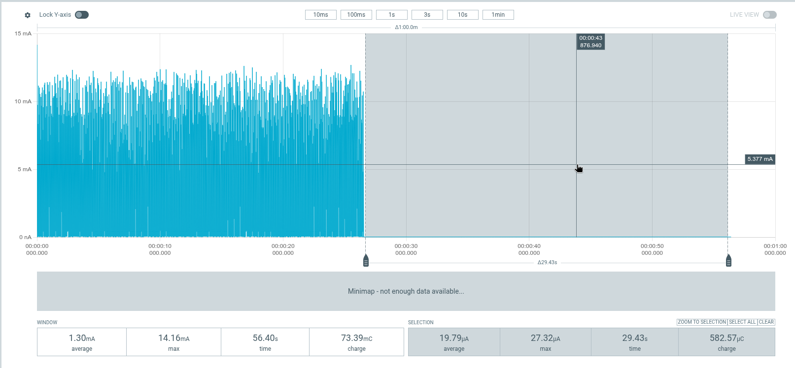
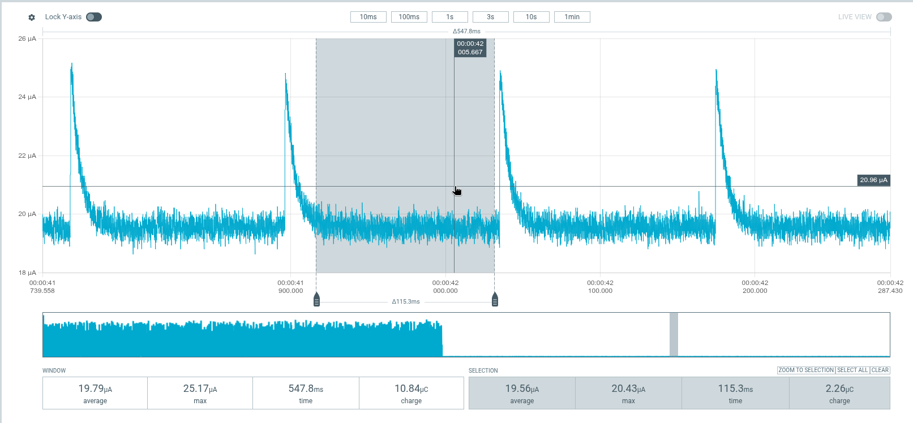
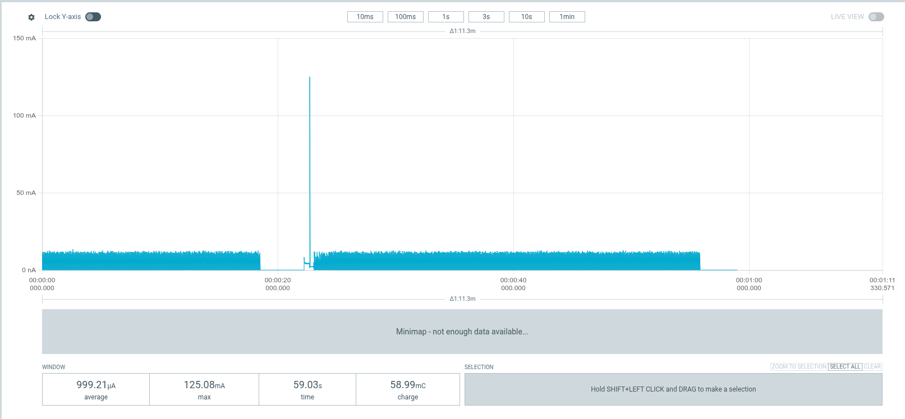
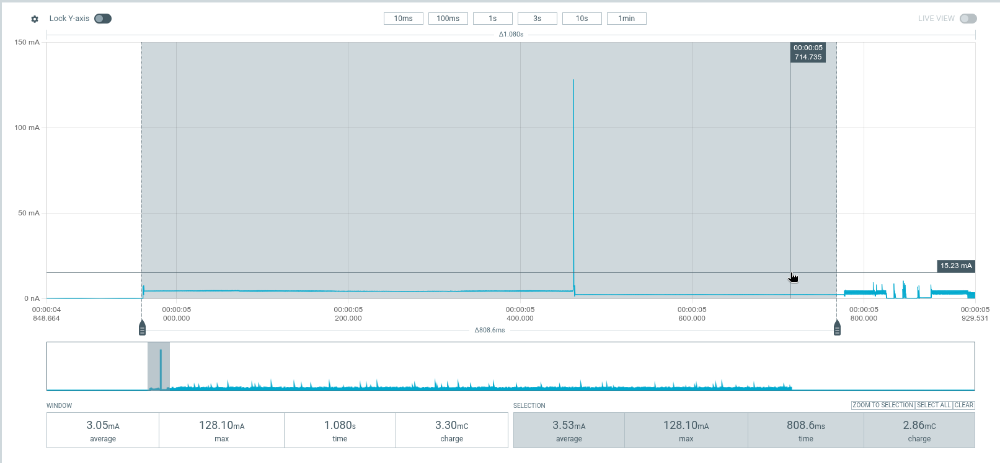
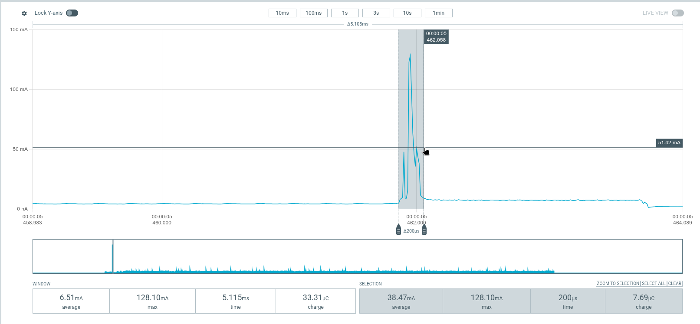

+++
title = "My Urchin can sleep deeper, if I let it disconnect"
date = 2026-11-11
draft = false
description = "A central-only SYSTEM_OFF experiment brings whole-board current to about 19.8 µA at 4.0 V, then tests whether the keyboard can wake, reconnect, type, and go back to sleep."
[taxonomies]
tags = ["embedded", "rust", "keyboards", "rmk", "bluetooth", "low-power"]
+++

In the [previous post](@/posts/urchin-connected-sleep-and-clocks/index.md),
my Urchin central reached about **62 µA asleep**, with both Bluetooth
connections retained. The displays were off, the low-frequency crystal
was finally doing its job, and a keypress didn't require a reboot and
reconnection.

I still like that arrangement. Taking my hands off the keyboard for a
minute shouldn't mean asking all the Bluetooth devices to introduce
themselves again.

But leaving it alone overnight is a different question. What would it
cost to stop keeping those connections alive? And, rather more
importantly, would it come back as a keyboard afterward?

The short answer is **about 19.8 µA for the whole measurement board at
a 4.0 V supply**. A local keypress woke the central, it reconnected to
the host and accepted keys, and I also checked its connection to the
other half. It could then enter SYSTEM_OFF again and return to the same
current floor.

That is enough to make me consider a second, longer idle timeout. It
isn't a production sleep policy yet.

<!-- more -->

## This time, actually turn it off

The [first post](@/posts/urchin-tap-hold-and-power/index.md) distinguished
screen sleep from MCU System OFF. Until now, the firmware cleared the
nice!view, cut its switched supply, and stopped periodic display work.
The MCU still detected keys and maintained the host and split links.

For this experiment, I made a disposable **central-only** firmware
snapshot. At the existing **30-second idle timeout**, after the display
had finished shutting down, it entered nRF52840 SYSTEM_OFF instead of
remaining in connected sleep.

The normal application checkout stayed untouched. The snapshot started
from [this application revision](https://github.com/felipebalbi/rmk-urchin/commit/041403d5ec7aa1186de57e7653db59e349b50bfb),
and kept its [pinned RMK revision](https://github.com/felipebalbi/rmk/commit/18300680e2f16046643b9f8151abae891df998a4).
I didn't update the library in the middle of the power measurement.
The [diagnostic patch](system-off-spike.patch) contains the temporary
application changes, not a proposed general-purpose RMK shutdown API.

The PPK2 supplied the central through its battery connection at
**4.0 V**, with keyboard USB and the debugger disconnected. These are
November 5 captures of the Urchin measurement board with its nice!nano
v2, not isolated measurements of the nRF52840 supply. The same setup
includes the board's other components and whatever current they still
draw while the MCU is off.

Throughout the measurements, I kept the supply at 4.0 V, which RMK
reported as about 65% battery charge.

## A key still needs a way in

SYSTEM_OFF is not a deeper version of waiting for the next Embassy
timer. Nordic's [nRF52840 Product Specification v1.5](https://files.seeedstudio.com/wiki/XIAO-BLE/nRF52840_PS_v1.5.pdf),
§5.3.3, describes the core being powered down and the system resetting
when it wakes. GPIO DETECT is one of its wake sources.

The central's matrix uses columns as outputs and rows as inputs. Before
entering SYSTEM_OFF, the diagnostic drives **all five columns high**
and configures **all four rows as pulled-down inputs with high-level
SENSE enabled**. Closing a switch raises its row through the matrix
diode and asserts DETECT.

The relevant row configuration is ordinary GPIO configuration, with
one extra field:

```rust
w.set_dir(Dir::Input);
w.set_input(Input::Connect);
w.set_pull(Pull::Pulldown);
w.set_sense(Sense::High);
```

The GPIO configuration is retained in SYSTEM_OFF. No periodic matrix
scan is needed to notice that level. I also replaced the running
matrix wait's SENSE settings and cleared stale latches, rather than
assuming its interrupt-driven configuration was already the desired
off-state configuration.

There is a little more to shutdown than writing the power register.
The display finishes its final SPI transaction and loses its supply
first. The diagnostic synchronously disables the Bluetooth controller,
then masks interrupts and disables PPI channels so the running tasks
cannot reconfigure the hardware. It stops any overlapping battery ADC
conversion and waits for STOPPED, disables SPIM2, and clears RAM
retention before calling `embassy_nrf::power::set_system_off()`.

Nordic explicitly requires ongoing EasyDMA transactions to finish
before SYSTEM_OFF. The ADC is worth remembering here: its 30-second
sampling cadence can overlap the 30-second idle timeout.

This is a non-returning measurement path. It does not hand those
peripherals back to their Rust owners and try to resume their futures.
Wake starts the MCU again through reset and the installed bootloader.
No RAM contents need to survive that trip.

A connected debugger also changes the experiment: the chip emulates
SYSTEM_OFF to keep debug resources available. I measured with it
disconnected, after a power cycle.

## About twenty microamps, not zero

The first useful off selection was almost 30 seconds long:

[](system-off-selection.png)

*Read the selected region: 19.79 µA over 29.43 seconds. The 1.30 mA
whole-window average includes the earlier active period. Neither the
height of the active peaks nor that mixed average is the off current.*

The CSV from that capture has **10 µs sample spacing**. Using a slightly
different boundary, from 27 seconds to its end, gives **19.792 µA over
29.41 seconds**. Moving the start to 30 seconds gives **19.791 µA**;
the 40–50 second interval gives **19.791 µA** too.

The [measurement summary](measurement-summary.json) records the source
CSV filenames, hashes, and calculation windows for these captures.

That's a stable result within this recording, not an uncertainty
estimate accurate to a thousandth of a microamp. **About 19.8 µA** is
the useful number.

Relative to the previously reported **62.07 µA connected-sleep
selection**, it is about **42.3 µA lower**, or **68% less current**.
The important qualification is also the point of the experiment: the
Bluetooth connections are no longer retained. These are different
operating states and captures, not a controlled attribution of every
saved microamp to one peripheral.

There is still a small repeating feature in the off trace:

[](system-off-detail.png)

*The 115.3 ms quiet selection averages 19.56 µA. The complete visible
window, including the small pulses, averages 19.79 µA. I kept the
pulses in the reported off average.*

Thresholding the CSV above 23 µA puts the pulses roughly **139 ms
apart**. I haven't isolated their source. That spacing alone doesn't
make them Bluetooth events, firmware timer wakeups, or a particular
board component. It also doesn't make this a measurement of the SoC's
datasheet SYSTEM_OFF current.

The remaining whole-board current is a separate investigation. I don't
need to explain it away to find this reduction useful.

## Coming back matters more than going away

I initially measured only the current after shutdown. No keypresses,
no wake test. A low number from a board that never comes back would
be easy enough to arrange.

The next recording started with the central off, included a local
keypress and startup, then ended with another shutdown. The off
selections on either side were **19.74 µA** and **19.75 µA**.

That established a repeatable electrical cycle. It didn't establish a
working Bluetooth keyboard. Host Bluetooth also misbehaved while I
was trying to pair, so I kept the successful connection check separate
from those first current captures.

Afterward, I verified that the central **reconnected to the host and
accepted keypresses**. I also made sure it connected to the split
peripheral half. The final recording captures the complete sequence:

[](system-off-full-cycle.png)

*Central at a 4.0 V supply. The displayed 999.21 µA average covers both
active periods and startup, not just SYSTEM_OFF. The large peak sets
the vertical scale; the two low-current intervals are not zero.*

The final CSV gives:

| Phase | Selected interval | Average current |
| --- | --- | ---: |
| Initial activity | 0–18.511 s | 1.047 mA |
| First settled SYSTEM_OFF window | 18.611–22.143 s | 19.76 µA |
| Second settled SYSTEM_OFF window | 55.931–58.936 s | 19.76 µA |

Wake activity begins around **22.243 seconds**. After startup, the
one-second windows generally return to roughly **1.03–1.05 mA**. The
second shutdown is around **55.831 seconds**. The two short off
selections confirm the return to the earlier floor; they don't replace
the longer first capture as the main off-current measurement.

The first wake key is lost. It triggers a reboot, and the firmware
doesn't save or replay that event. RAM retention is disabled too.
Subsequent keypresses worked after reconnection; I haven't timed that
reconnection or stress-tested repeated wakeups.

## The tall startup peak isn't the whole bill

One of the wake captures contains an exported peak of **128.10 mA**.
That certainly gets the plot's attention.

[](wake-startup.png)

*The GUI startup selection contains 2.86 mC over 808.6 ms. A slightly
wider CSV window, 4.95–5.78 seconds, contains 2.886 mC over 0.83 seconds.
Neither selection identifies when Bluetooth reconnection completed.*

Zooming into the peak makes the scale less alarming:

[](wake-peak.png)

*The selected 200 µs contains about 7.7 µC. That's roughly 0.27% of
the broader startup window's charge, despite dominating its vertical
scale.*

I haven't identified that peak's source. I'm strictly reporting what
the PPK2 export contains. No other claims are made.

The broader **2.886 mC** startup selection is about **0.00080 mAh**.
That's small enough to be encouraging. It is not a complete
measurement of the additional cost of waking from SYSTEM_OFF: that
would need an ordinary connected-wake comparison and a boundary that
includes the full reconnection process. I won't turn this selected
window into a precise break-even timer.

## Thirty seconds for the experiment, perhaps thirty minutes for use

I don't want every short pause to reset the keyboard. The experiment
used the existing 30-second timeout so I could measure it without
waiting half an hour for every run.

The policy I'm considering is two-stage:

- After a short idle period, keep today's connected sleep: displays
  off, links retained, quick wake.
- After perhaps **30 minutes without activity**, enter SYSTEM_OFF and
  accept reset and reconnection on the next local keypress.[^wake-both-halves]

For a deliberately simple eight-hour idle budget, using the earlier
62.07 µA connected-sleep result and this experiment's 19.79 µA off
result:

| Hypothetical central idle policy | Charge over eight hours |
| --- | ---: |
| Connected sleep throughout | 0.497 mAh |
| 30 minutes connected sleep, then 7.5 hours SYSTEM_OFF | 0.179 mAh |
| Difference | **0.317 mAh saved** |

With eight hours idle each day, that saves enough charge to power the
central for another **0.31 hours, or about 18½ minutes**, at the
**1.03 mA awake-idle current** measured in the previous post. Typing
may draw a different current.

That's about **64% less charge in that simplified overnight budget**.
It uses steady-state currents and leaves out the common initial
awake period and the eventual wake/reconnection cost. It isn't a
measurement of an implemented 30-minute policy.

## The daily budget is less dramatic

The [previous post's battery-runtime table](@/posts/urchin-connected-sleep-and-clocks/index.md#what-does-that-buy-a-110-mah-battery)
was for continuous sleep. Its daily-use example, with **four hours
active and twenty hours in connected sleep**, came to about **20.5
ideal days** from the central's 110 mAh battery.

Keeping those four active hours, but replacing eight of the connected
idle hours with SYSTEM_OFF, gives:

| State | Hours per day | Current | Daily charge |
| --- | ---: | ---: | ---: |
| Active | 4 | 1.03 mA | 4.120 mAh |
| Connected idle | 12 | 62.07 µA | 0.745 mAh |
| SYSTEM_OFF | 8 | 19.79 µA | 0.158 mAh |
| **Total** | **24** | | **5.023 mAh** |

That's **21.9 ideal days**, compared with the earlier **20.5 days**:
about **1.4 more days per charge**, or **6.7% longer runtime**. The four
active hours alone cost 4.12 mAh, about 82% of the new daily budget.
Reducing overnight current can't do much about that part.

This example assumes eight full hours in SYSTEM_OFF, unlike the
overnight table's half-hour connected grace period followed by 7.5
hours off. It still uses awake-idle current as the active-use estimate
and excludes reboot and reconnection overhead.

Each half has its own **110 mAh battery**. These numbers concern the
central's battery only; I can't apply them to both halves or call the
68% sleep-current reduction a threefold increase in overall battery
life. Awake time still matters, as do battery self-discharge, cutoff,
and current changing as the battery voltage falls. A fixed 4.0 V
measurement isn't a battery rundown.

There is also a split-keyboard catch that matters more than another
decimal place: **the peripheral cannot wake a central whose BLE radio
is off**. This experiment wakes from a local central key. A usable
two-half policy needs to make that behavior intentional, rather than
surprise me when my first key after lunch happens to be on the right.
I haven't tested a SYSTEM_OFF image on the peripheral.

## Where I stopped

This was a measurement spike, not a replacement for the connected
sleep behavior I already like. The normal firmware remains unchanged,
and there is no new 30-minute timer yet.

What I have now is a central that can reach about **19.8 µA whole-board
current at 4.0 V**, wake through a local keypress, reconnect to the host
and the other half, accept typing, and go back to the same floor.

The earlier improvements made keeping the conversation going cheaper.
This one asks whether, after enough silence, it's worth hanging up.

I'm certainly considering it, but if my four-hour active-use estimate
is correct, the extra **1.4 days per charge** is close to negligible
for me.

[^wake-both-halves]: If both halves enter SYSTEM_OFF, each needs its own
    local keypress to wake, reset, and reconnect. Neither half can wake
    the other over BLE while its radio is off. The central reconnects to
    the host, and the peripheral reconnects to the central.
