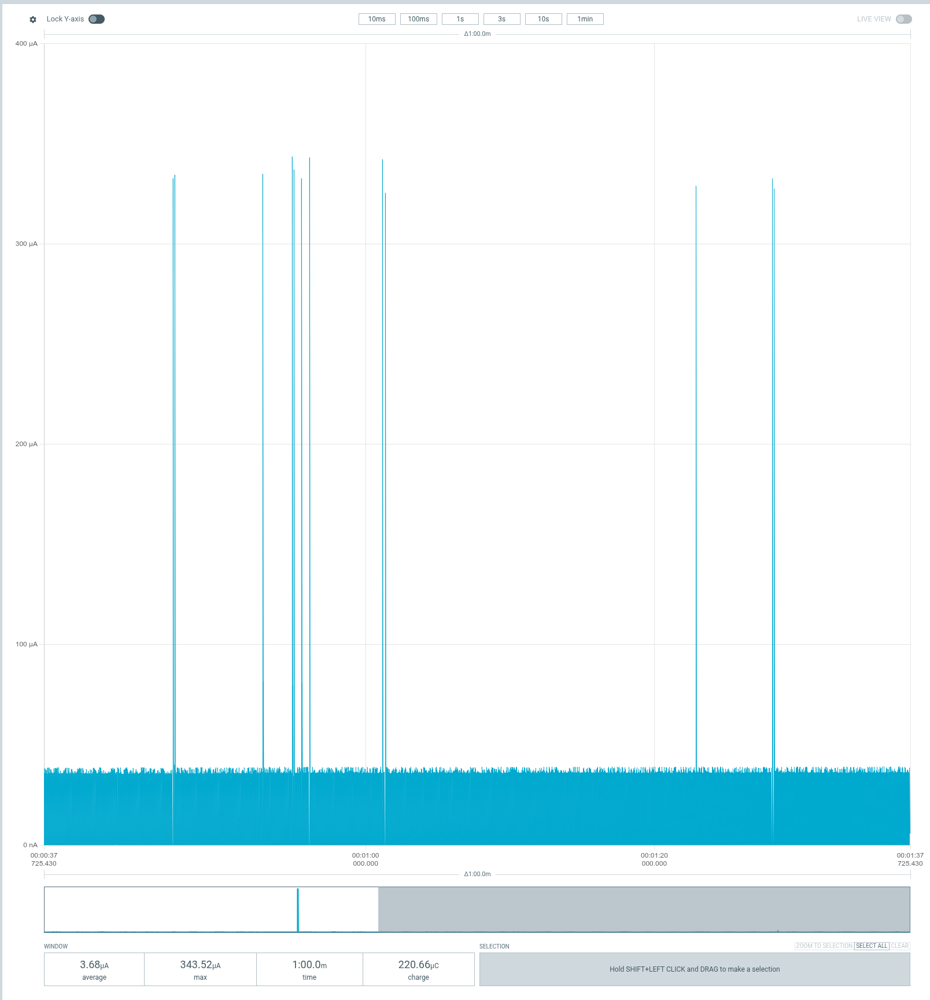
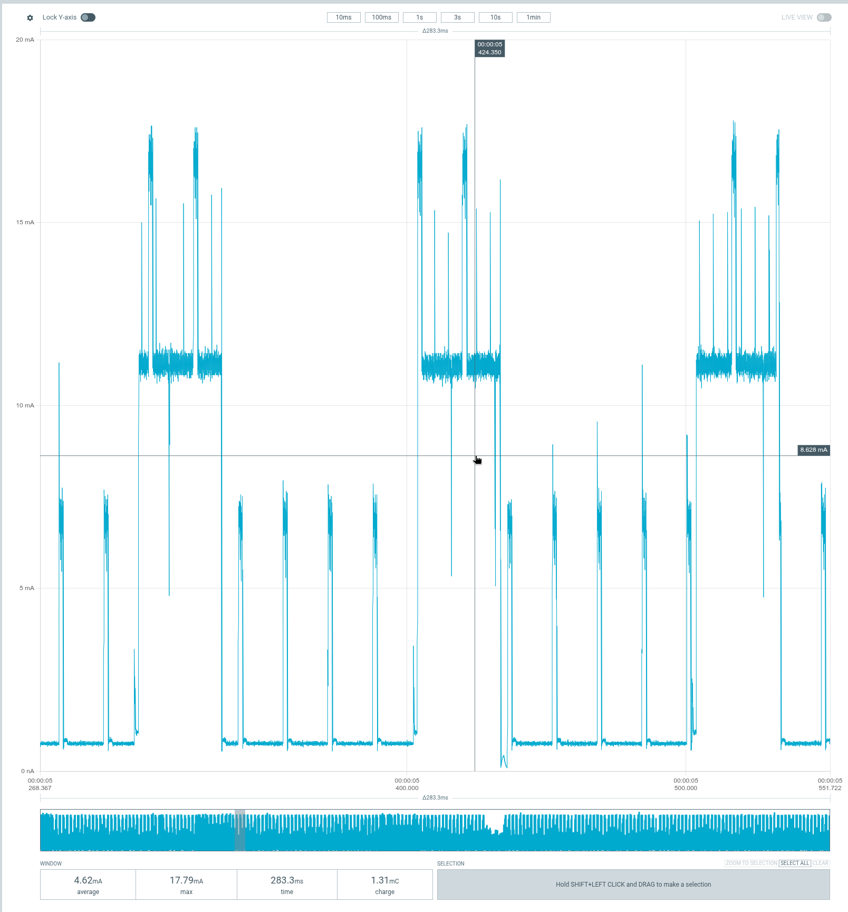
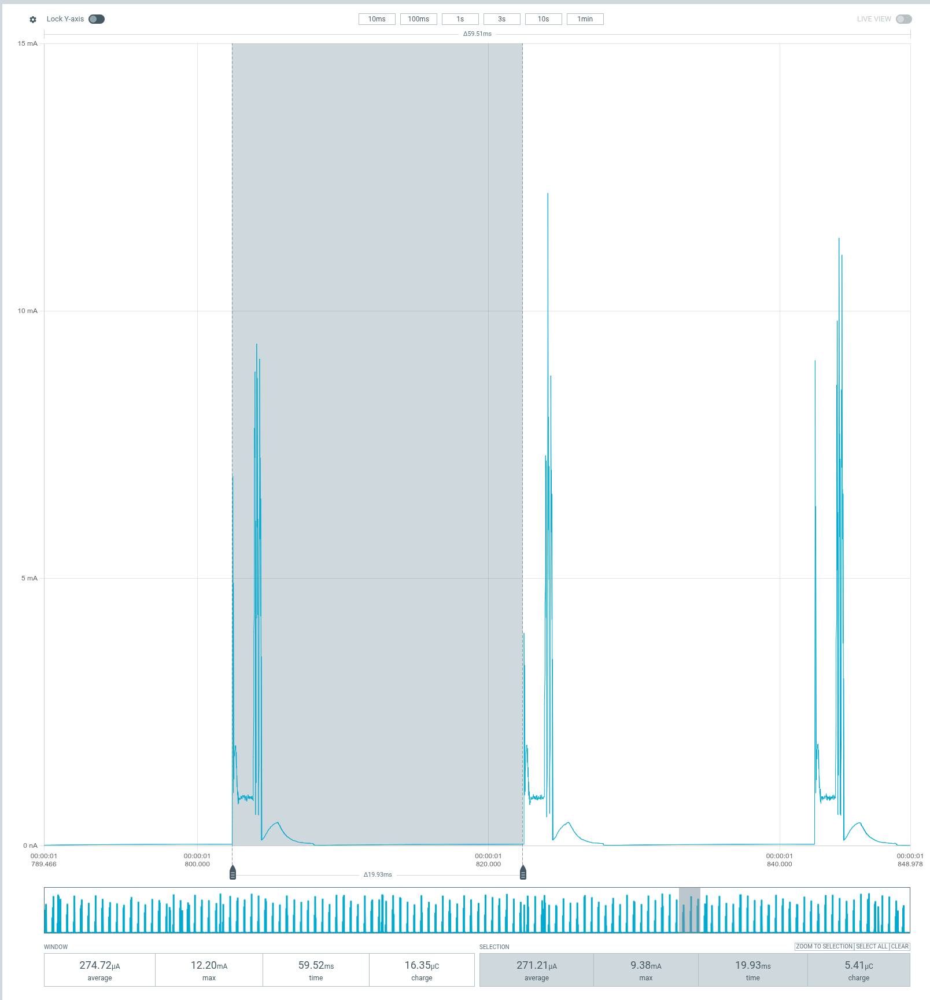
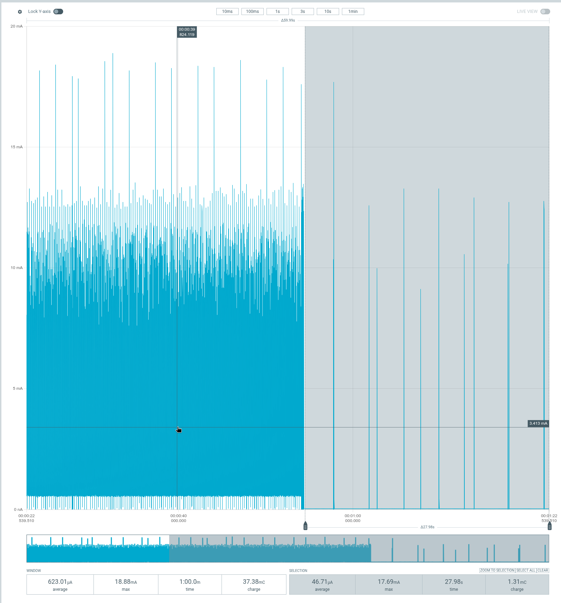

+++
title = "Teaching my Urchin to type, then figuring out where the power went"
date = 2026-10-21
draft = true
description = "Buffered tap-hold on RMK, sleeping nice!view screens, and a power investigation that nearly blamed a few-microamp display for a missing-half radio scan."
[taxonomies]
tags = ["embedded", "rust", "keyboards", "rmk", "bluetooth", "low-power"]
+++

My keyboard already worked with ZMK. I wasn't trying to rescue a broken
keyboard. I just wanted it to run [RMK](https://rmk.rs/).

The keyboard is an [Urchin](https://github.com/duckyb/urchin), a small split
keyboard with nice!nano controllers and nice!view displays. Moving it
from ZMK to RMK meant bringing along the tap-hold behavior I liked, not
just copying the keymap and calling it done.

That conversion led to a buffered tap-hold implementation, some display
power management, and quite a few sessions with Nordic's Power Profiler
Kit II.

It also led to a rather convincing wrong explanation for where the power
was going. At one point I was considering replacing the displays with
e-paper. The displays were drawing about **3.7 µA**. The board I was
measuring was busy looking for another keyboard half that wasn't there.

Oops.

<!-- more -->

## First, make the typing work

Home-row modifiers are great until the firmware decides that an ordinary
letter was actually a modifier. On my layout, for example, `A` doubles
as Shift. Thumb keys also double as layer switches. The firmware has to
decide whether I meant a tap or a hold while other keys are already
arriving.

Fast typing, intentional capitals, and layer chords all need slightly
different things. Just shortening the tapping term isn't a complete
answer. Neither is deciding that every key pressed during normal typing
must be a tap: sometimes I really do want that Shift or layer.

The approach I implemented in my RMK fork is to **buffer the following
events while a tap-hold key is undecided**. Once the owner resolves, it
commits first, and the buffered events follow in order, using their
original logical timestamps. That gives the modifier or layer decision
a chance to take effect before the following key is interpreted.

For my Urchin, the configuration keeps a 200 ms hold timeout, enables
permissive hold and same-hand tap filtering for the home-row modifiers,
and uses a separate normal-mode policy for the thumb keys. Flow-tap is
disabled, as is quick-tap repeat.

The feature is opt-in. I didn't want to change how an existing RMK
keyboard behaves just because someone updates the dependency.

There are limits, too. The implementation has a bounded event queue; it
doesn't pretend to have unlimited memory. It also isn't a claim of full
ZMK behavioral compatibility. The goal was to reproduce the typing
policy I actually use, not every possible tap-dance or combo behavior.

On the hardware, this has been working well: fast typing, mixed-case
letters, and layer switching all feel much better. The changes are in
[my RMK fork](https://github.com/felipebalbi/rmk/commit/5f0ab05292f6d757d25c0491071c6c8190318831),
and the keyboard configuration is in
[rmk-urchin](https://github.com/felipebalbi/rmk-urchin).
I want some ordinary daily use before turning the buffered tap-hold work
into an upstream PR. A good test suite matters, but so does spending a
few days typing things other than test cases.

## Then, let the screens sleep

The keyboard already had a 30-second idle timeout. The application needed
to do something useful with the sleep event.

Both screens now finish their current transaction, receive a final clear,
and lose their switched supply. While asleep, they stop periodic display
work entirely. Status events still update the software state in RAM.
When the keyboard wakes, the application restores power, waits for the
supply to settle, reinitializes the panel, and redraws the current state.

This isn't MCU System OFF. The keyboard can still maintain its BLE links
and detect keys.[^connected-sleep] It's the display application responding to RMK's
sleep/wake events.

I also disabled USB CDC logging for the normal firmware. USB HID and Vial
remain enabled; removing a logger didn't require removing USB keyboard
support.

The screen sleep and wake behavior worked on the real keyboard. The
application's host test suite reached 45 passing tests, including checks
around sleep handling and in-flight display transfers. Those tests do
not measure current, certify the physical power rail, or tell me what
a radio is doing. That's why the PPK2 came out.

## A display can trigger work without consuming the power

The first whole-board measurements were not encouraging. Some awake
runs were in the several-milliamp range. When the keyboard slept, the
current dropped dramatically. It was tempting to call the difference
"display power."

That description mixed up two different things:

- Current going into the physical display.
- Everything else the firmware and MCU do while the display is awake.

The nice!view is a Sharp memory LCD, not an e-paper panel. It retains the
pixel data, so unchanged content doesn't need to be uploaded again.
There is still LCD polarity maintenance to do. On this board, COM
polarity is controlled through the serial interface rather than an
external inversion signal. Our awake driver alternates it with short
HOLD commands every 16 ms; full images are sent when the visible state
changes.

I checked the
[LS011B7DH03 panel specification](https://web.archive.org/web/20240115011246id_/https://www.sharpsde.com/fileadmin/products/Displays/Specs/LS011B7DH03_24Nov17_Spec_LD-29Y03.pdf)
rather than treating generic Sharp Memory LCD advice as interchangeable.
Its table 6-3-1 gives a 57–70 Hz frame frequency for serial COM control,
and its polarity-driving notes describe 60 polarity changes per second.
That is **not** a requirement to resend the framebuffer 60 times a second.

Even so, why would two bytes over SPI leave me looking at milliamps?

I eventually measured the display supply separately on my actual
keyboard, using the PPK2 in ammeter mode. The result was **3.68 µA
averaged over a minute** with the display active.

[](niceview-supply.png)

*This is the display supply, not the whole keyboard. The average at the
bottom is the useful number; the short peaks don't make this a
milliamp-scale load.*

The physical panel wasn't where the missing milliamps were going.
Replacing it with e-paper might change how often the MCU needs to do
display work, but it wasn't a fix for a panel that was burning through
the battery. The panel wasn't doing that.

## A cancellation guard wasn't the answer either

We had an application-side cancellation wrapper around Embassy's SPI
driver. Its job is to stop an unfinished DMA transfer before a cancelled
future can release the buffers. There is a synchronous wait in that abort
path, which made it worth checking.

I built an isolated diagnostic image without the wrapper. Awake
consumption stayed around **4.4–4.5 mA**. That did not support the guard
as the explanation for the sustained draw. The normal firmware keeps
the protection.

I haven't proved that every remaining microamp is necessary, or ruled
out improvements in our driver or `embassy-nrf`. What I don't have is
evidence that a HAL defect explains these measurements. Removing a
safety mechanism and seeing no useful improvement isn't a reason to
leave it removed.

## The suspiciously regular 30 ms plateau

Zooming in made the awake current much more interesting. There were
small recurring bursts and much longer high-current plateaus. The
plateaus were about **30 ms long**, repeating every **100 ms**.

[](split-discovery.png)

*An early whole-board capture from the measurement setup. The window
averages 4.62 mA. This isn't an isolated measurement of SPI or the panel.*

I connected CS and SCLK to the PPK2's digital inputs and exported the
current and digital channels together. The sample spacing was 10 µs, so
it couldn't decode a 1 MHz SPI clock reliably. CS was still enough to
separate short commands from a full image transfer.

In that export, the CS-like strobes were only about **0.81–0.87 ms**
long, spaced roughly **16 ms** apart. There were no long CS assertions
corresponding to repeated full-frame writes. Meanwhile, the complete
high-current plateaus measured **29.75 ms**, with their starts exactly
**100 ms** apart.

Then we looked at RMK's split discovery configuration:

```rust
// Split scan window
Duration::from_millis(30)

// Scan interval
Duration::from_millis(100)
```

Well, hello there.

The bare nice!nano[^matrix-diode] was running **split-central firmware**. The other
half wasn't connected. It was supposed to look for it, and it was doing
exactly that. The
[pinned source](https://github.com/felipebalbi/rmk/blob/5f0ab05292f6d757d25c0491071c6c8190318831/rmk/src/ble/scan.rs)
spells out the 30 ms window and 100 ms interval.

An isolated build that didn't run split discovery brought awake current
down to around **1.8 mA** in that test setup. A later connected sleep
selection measured **68.78 µA**. I had also changed the host pairing
state during this part of the investigation, so these aren't numbers
to subtract blindly from earlier runs. They did give me a much better
baseline than a board searching for an absent peer.

The important correction was bigger than the number: **sleep stopped
more than display work**. It also changed what the split radio was
doing. The big drop at the idle timeout had never isolated the display
as the cause.

## Finally, measure an actual split

I found another nice!nano, flashed the normal central and peripheral
images, and connected the two. No need to redesign anything. Once all
configured peripheral halves are connected, the central stops discovery.

The central's sleeping consumption was higher than the host-only
baseline: roughly **270–300 µA** in the selected windows. Zooming in
showed bursts almost exactly **20 ms apart**.

[](central-sleep.png)

*The central is connected to the host and its peripheral half. The
selection spans almost one 20 ms interval, not just the pulse.*

That matches RMK's requested sleeping split interval when a host
transport is active. The central schedules connection opportunities
every 20 ms. The peripheral is allowed to skip many of them through
peripheral latency; that doesn't give the central the same event-skipping
behavior.

This doesn't imply a large stream of application messages between the
halves. Empty link-layer exchanges and the work around connection
events still cost energy. A current trace doesn't tell me the contents
of those packets, but the timing and configured interval fit.

The peripheral was the pleasant surprise:

[](peripheral-sleep.png)

*Read the selection at the bottom right: 46.71 µA over 27.98 seconds.
The 623.01 µA whole-window average includes the earlier awake period.*

In that run, its selected awake period averaged about **1.13 mA**, then
the sleeping selection came down to **46.71 µA**. Those sparse bursts
are consistent with the peripheral taking advantage of its allowed
event skipping.

So the useful sleep figures, **before enabling subrating**, were:

| Setup | Measured sleep average |
| --- | ---: |
| Test central, host connected, split discovery disabled | About 69 µA |
| Normal split central, host and other half connected | About 270–300 µA |
| Normal split peripheral, connected to central | About 47 µA |

These are different setups and selected measurement windows, not a
controlled battery-runtime benchmark. They are much more useful than
my original assumption that both halves would consume roughly the same
amount while sleeping.

## One more knob: connection subrating

RMK already has an optional
[`subrating` feature](https://github.com/felipebalbi/rmk/blob/5f0ab05292f6d757d25c0491071c6c8190318831/rmk/src/split/ble/central.rs#L268-L347)
for the split link, with nRF52840 support. I hadn't enabled it.

Unlike peripheral latency alone, connection subrating lets both sides
skip connection events. In the pinned implementation, when a host is
connected, the sleeping split link requests a factor of 30 on a 7.5 ms
base interval. That gives roughly **225 ms between scheduled split
events**, rather than the ordinary 20 ms sleep interval.

The cost is wake latency. RMK documents about **116 ms on average and
232 ms worst-case** for the first peripheral-side keypress after sleep.
Those are upstream figures, not measurements of my keyboard. A local
keypress on the central can initiate wake without waiting for that
peripheral event. The split link returns to its fast settings after wake.

For me, a couple hundred milliseconds on the first key after an idle
period is a reasonable thing to try. I enabled the existing feature on
both halves of my real firmware, kept the 30-second idle timeout, and
built a rollback pair before changing it.

**I don't have post-subrating power measurements or a week of typing
results yet.** The trial is the next step. In particular, I want to
check quick peripheral taps that are released before the next event:
delayed delivery is acceptable; a missing press or a stuck key isn't.
I also want to check held keys and reconnection from either half.

Changing RMK's feature set can reset stored settings and bonds, so this
is a flash-both-halves change with possible host and split re-pairing.

## Where I stopped

The buffered tap-hold behavior is working well enough that I want to
use it normally for a while. Screen sleep works. The physical display
is a tiny load. The missing-half scan explains the big recurring
plateaus, and the connected central's 20 ms radio schedule explains
why its sleep current is higher than the peripheral's.

There is still awake-state overhead worth understanding. I haven't
turned a few short captures into a claim about how many days the
batteries will last, and I haven't demonstrated that subrating improves
this particular keyboard yet.

But I no longer need to replace a perfectly reasonable display to fix
a radio search. I'll take that.

[^connected-sleep]: In my ZMK setup, I kept losing the connections after
    idle periods. With this RMK setup, the halves keep their link and the
    central stays connected to the host while sleeping. Wakeups have been
    short, and getting back to typing feels much smoother. I prefer this
    behavior: the retained connections and quick wakeups make for a really
    nice typing experience. That's my experience with these configurations,
    not a claim that every ZMK keyboard disconnects when idle.

[^matrix-diode]: One early measurement had to go in the bin: I put a
    switch on the bare test board and forgot its matrix diode. That trace
    wasn't valid evidence of key handling, so I repeated the experiment
    with the diode installed.
